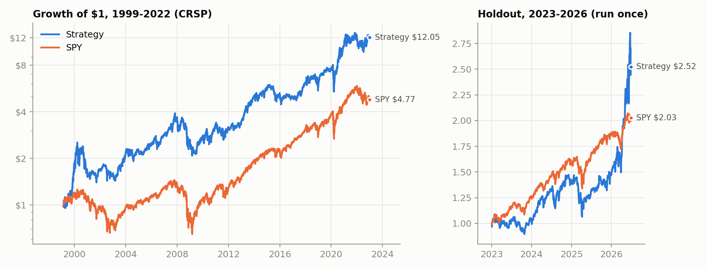

# Momentum Clustering

A monthly K-means momentum strategy on large US stocks: cluster the universe on technical, factor and momentum features, hold the momentum cluster, and weight it with a maximum-Sharpe optimiser.

Research code. It places no orders and is not financial advice.

## The model

- **Universe:** the 500 largest US stocks each month from CRSP, 1997 to 2022, which keeps delisted firms (no survivorship bias). The strategy trades the largest 150.
- **Features:** RSI, MACD, Bollinger %B, volatility, ATR, past returns, rolling Fama-French five-factor betas, and three momentum factors:
  - 12-1 month momentum (the return from 12 months ago to 1 month ago);
  - distance to the 52-week high;
  - volatility-scaled 6-month momentum.
- **Clustering:** every feature is z-scored across stocks each month, and K-means groups them into 4 clusters. The starting centroids are seeded on 12-1 month momentum, so the top cluster means "strong long-run trend" every month.
- **Portfolio:** the top cluster's stocks with a positive 12-month return, weighted by maximum Sharpe on a Ledoit-Wolf covariance (10% cap per name), rebalanced monthly with 10 basis points of cost per unit of turnover.

## Results

**1999 to 2022 (CRSP):**

| | Strategy | SPY |
|---|---|---|
| CAGR | 11.0% | 6.8% |
| total return | 1,105% | 377% |
| Sharpe | 0.57 | 0.43 |
| max drawdown | -46.9% | -55.2% |
| alpha a year | 5.7% (t = 1.89) | |
| beta | 0.88 | |

**Holdout, January 2023 to June 2026 (Yahoo, point-in-time S&P 500), run once:**

| | Strategy | SPY |
|---|---|---|
| total return | 152% | 103% |
| CAGR | 30.4% | 22.5% |
| Sharpe | 1.06 | 1.42 |
| alpha a year | 0.8% (t = 0.08) | |
| beta | 1.40 | |

(Sharpe is the mean daily return over its standard deviation for both, with no risk-free rate subtracted.)

The holdout's extra return came from a higher beta, not alpha: the strongest 12-month trends in 2023 to 2026 were high-beta technology stocks.



Most of the lead over 1999 to 2022 was built in 1999 and 2000, when the strategy held the trending technology names. It fell less than SPY in both the 2000 to 2002 and 2008 bear markets, but lagged in the 2009 rebound, when momentum strategies as a group crashed as beaten-down stocks bounced.

## The three momentum factors

| Factor | Definition | Why it helps |
|---|---|---|
| 12-1 month momentum | return from 12 months ago to 1 month ago | the classic momentum signal (Jegadeesh and Titman, 1993); skipping the latest month avoids its short-term reversal |
| distance to the 52-week high | price / its highest close of the last year | stocks near their highs tend to keep rising, as investors anchor on the high (George and Hwang, 2004) |
| volatility-scaled momentum | 6-month return / 6-month volatility | ranks trends by how smooth they were, so one jump doesn't count as a trend |

Across stocks, only 12-1 momentum is significant on its own (t = 2.2 in the Fama-MacBeth test). The other two shape the clusters but add little by themselves.

## Design choices

- **Z-scoring every feature across stocks each month.** K-means works on distances, so without it the features on the biggest scale would decide the clusters.
- **Seeded centroids.** With random starts, "cluster 3" could mean something different every month. Seeding the centroids at fixed levels of 12-1 momentum makes the top cluster the high-momentum group every month, so the strategy holds the same kind of stock throughout.
- **The positive 12-month filter.** Inside the cluster, only stocks that actually went up over the year are held, which removes names that cluster with the trend on other features but haven't moved.
- **Ledoit-Wolf covariance.** With 15 to 25 stocks and one year of daily data, the sample covariance is noisy, and the optimiser would chase that noise. Shrinking it toward a structured target stabilises the weights.
- **Point-in-time data.** Membership, features and betas only use information available at each month-end, and the betas are lagged a month.

## How it was tested

- **One change at a time.** Each design change was kept only if it raised Sharpe in both halves of the sample (1999 to 2010 and 2011 to 2022), with the rule written down before anything ran (`experiments.py`).
- **Across stocks.** Fama-MacBeth regressions over 286 months show 12-1 momentum predicts higher next-month returns (t = 2.2) and 20-day RSI lower ones (t = -3.0), which is why the centroids are seeded on momentum (`signal_test.py`).
- **Once on unseen data.** The final design was chosen on CRSP and then run once on 2023 to 2026, data the choice never saw (`holdout.py`).

| Variant tested on CRSP | Sharpe 1999-2010 | Sharpe 2011-22 |
|---|---|---|
| clusters seeded on RSI | 0.08 | 0.58 |
| 6 clusters | 0.25 | 0.64 |
| equal weights instead of max Sharpe | -0.04 | 0.63 |
| **seeded on 12-1 momentum (final)** | **0.53** | **0.61** |
| SPY | 0.20 | 0.72 |

Full tables are in `results/`.

## Limitations

- Alpha is not significant at the usual 5% level (t = 1.89), and the holdout is only 3.5 years.
- The CRSP files have no delisting returns, so a bankruptcy drops out at its last price rather than near -100%.
- CRSP here has daily returns but no high, low or volume, so volatility and ATR use close-to-close versions and the universe is ranked by size.
- Yahoo, used for 2011 onward and the holdout, is missing most delisted stocks (it served 622 of 822 past S&P 500 members).

## Running it

```bash
pip install -r requirements.txt
python momentum.py             # Yahoo data, 2011-2026: downloads once and caches to cache/
python experiments.py          # design changes, both halves
python signal_test.py          # Fama-MacBeth and factor-adjusted tests

# CRSP, 1997-2022 (licensed data, not included; set CRSP_DIR)
python crsp_data.py
MOM_DATA=crsp python experiments.py
MOM_DATA=crsp python signal_test.py
python holdout.py              # choose on CRSP, test once on 2023-2026
```

| File | What it is |
|---|---|
| `momentum.py` | data, features, clustering, weighting, back test and evaluation |
| `crsp_data.py` | the same panel built from CRSP |
| `experiments.py`, `signal_test.py`, `holdout.py` | the tests above |
| `sp500_pit.py` | point-in-time S&P 500 membership |
| `results/` | every table |

Tested with Python 3.13.
